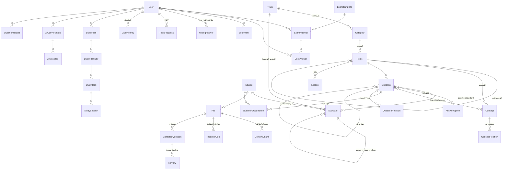

# 04 — تصميم قاعدة البيانات

> المخطط الكامل القابل للتشغيل: [`packages/db/prisma/schema.prisma`](../packages/db/prisma/schema.prisma) (PostgreSQL، تم التحقق من صحته بـ `prisma validate`).

## 1. لماذا PostgreSQL؟
- المحتوى **علائقي بطبيعته** (سؤال ← خيارات ← مفاهيم ← مصادر ← ظهورات ← محاولات ← إجابات)، والتحليلات (أكثر الأسئلة خطأً، أصعب المحاور) استعلامات SQL مباشرة.
- يوفر في قاعدة واحدة: البحث النصي (`tsvector`)، والبحث التقريبي (`pg_trgm`) لكشف التكرار والأخطاء الإملائية، والبحث الدلالي (`pgvector`) للمساعد الذكي. **لا نحتاج خدمة بحث منفصلة في البداية.**
- يعمل طابور المهام (`IngestionJob`) داخله بـ `FOR UPDATE SKIP LOCKED`، فلا نحتاج Redis.

## 2. الخريطة العامة (ERD مبسط)



## 3. الجداول المطلوبة ← ما يقابلها في المخطط

| طلبك | الجدول | ملاحظات التصميم |
|---|---|---|
| Users | `User` (+ `AuthSession`, `AuthAccount`, `AuthVerification`) | الأدوار: طالب / محرر / مدير. موعد الاختبار والوقت اليومي على المستخدم |
| Questions | `Question` | `origin` (من ملف/استرجاع/معدّل/تدريبي/AI) + `answerConfidence` + `occurrenceCount` + إحصاءات حية + `regulationSourceId` (إصدار النظام الذي تعتمد عليه الإجابة) |
| Answers | `AnswerOption` | `isCorrect` + `whyWrong` لكل خيار |
| Categories | `Track` ← `Category` | الاختبار (عام/تخصصي) ← المجال مع **وزنه** في الاختبار الحقيقي |
| Topics | `Topic` (شجرة) + `Concept` | المحور ← الموضوع. المفاهيم طبقة مستقلة للبحث والبطاقات والمقارنات |
| Sources | `Source` | النوع، السنة الهجرية، الموثوقية 1–5، **سجل الإصدارات** (الجهة، الإصدار، حالي/ملغى، يحل محل)، و**حقوق الاستخدام** |
| Exams | `ExamTemplate` | القوالب الجاهزة؛ الاختبار المخصص يحفظ إعداداته على المحاولة |
| ExamAttempts | `ExamAttempt` | مؤقت **من الخادم** (`deadlineAt`)، ترتيب الأسئلة، تحليل لكل مجال |
| UserAnswers | `UserAnswer` | الخيار، الوقت، ترتيب الخيارات المعروض، **ثقة الطالب بإجابته** |
| Bookmarks | `Bookmark` | نوعان: محفوظ ⭐ / علامة للمراجعة ⚑ |
| WrongAnswers | `WrongAnswer` | **بطاقة تكرار متباعد (FSRS)** لكل سؤال أخطأ فيه أو خمّنه، تخرج عند الإتقان |
| StudyPlans | `StudyPlan` ← `StudyPlanDay` ← `StudyTask` | الخطة لها نسخ (تُعاد عند التأخر) |
| StudySessions | `StudySession` | جلسات فعلية مرتبطة بمهام الخطة |
| Files | `File` + `IngestionJob` + `ContentChunk` | بصمة `sha256` تمنع تكرار الرفع؛ المقطع وحدة الاستشهاد للمساعد |
| ExtractedQuestions | `ExtractedQuestion` | منطقة الانتظار: النص الخام، الحالة، الثقة، الأعلام، أقرب سؤال منشور |
| Reviews | `Review` (مراجعة تحريرية) + `QuestionReport` (بلاغات الطلاب) | فسرت "Reviews" بالمعنيين؛ كلاهما ضروري |
| Progress | `TopicProgress` + `DailyActivity` + `LessonProgress` | الإتقان لكل محور + نشاط يومي للسلسلة |

**إضافات لم تطلبها لكنها ضرورية:** `Standard` + `QuestionStandard` (ربط كل سؤال بمؤشرات المعايير الرسمية لهيئة تقويم التعليم والتدريب، منفصلًا عن تقسيمنا التعليمي للمحاور، حتى إذا أصدرت الهيئة معايير جديدة نعيد الربط دون إعادة كتابة الأسئلة)، `QuestionOccurrence` (دليل التكرار)، `QuestionRevision` (سجل التعديلات والتراجع)، `ConceptRelation` (المفاهيم المتشابهة)، `Lesson` (محتوى ذاكر والمراجعة المكثفة)، `AiConversation/AiMessage` (المساعد مع الاستشهادات)، `Purchase` (الدفع)، `AuditLog` (من غيّر ماذا).

## 4. قرارات تصميم مهمة

1. **النص مرتين:** الأصلي للعرض، و`*Norm` مطبّع للبحث وكشف التكرار. التطبيع في دالة واحدة مشتركة (`packages/core/arabic`) يستخدمها الموقع والـ Worker، حتى لا يختلف تطبيع البحث عن تطبيع الفهرسة.
2. **الظهورات بدل التكرار الأعمى:** السؤال المكرر لا يُنسخ؛ بل يضاف له `QuestionOccurrence`. عدد المصادر **المستقلة** = قوة الدليل على أنه "متكرر".
3. **لا حذف فعلي للأسئلة المنشورة:** أرشفة فقط، لأن محاولات الطلاب السابقة تشير إليها.
4. **لقطة الإعدادات في المحاولة:** تعديل قالب الاختبار لاحقًا لا يغير نتائج قديمة.
5. **الإتقان لا يساوي نسبة الصواب:** `TopicProgress.mastery` يعطي وزنًا أكبر للمحاولات الحديثة، ويخصم الإجابات الصحيحة الموسومة "تخمين".
6. **الإحصاءات الثقيلة ليلية:** `correctRate` و`discrimination` لكل سؤال تُحسب بمهمة مجدولة. السؤال الذي يخطئ فيه **المتفوقون** أكثر من الضعفاء غالبًا مفتاح إجابته خاطئ، فيظهر للمؤسس في التحليلات.
7. **الأنظمة المتغيرة تلقائيًا:** كل سؤال تعتمد إجابته على نظام (مثل قواعد السلوك والمواظبة) يرتبط بإصداره. عند تسجيل إصدار جديد ووسم القديم "ملغى"، تُعلَّم كل الأسئلة المرتبطة به تلقائيًا للمراجعة.
8. **حقوق المصادر:** ملازم وتجميعات الجهات التجارية تُسجل `ANALYSIS_ONLY`: نحللها لاستخراج المفاهيم وتكرارها فقط، ولا يُنشر نصها. النظام يمنع نشر سؤال نصه مأخوذ حرفيًا من مصدر بهذا الوسم.
9. **الخصوصية:** حذف الحساب يحذف الإجابات والمحادثات (Cascade)، وتبقى إحصاءات مجمعة مجهولة الهوية فقط.

## 5. الفهارس والبحث (هجرة SQL خام)

```sql
CREATE EXTENSION IF NOT EXISTS pg_trgm;
CREATE EXTENSION IF NOT EXISTS vector;

-- بحث نصي على النص المطبّع (إعداد 'simple' لأن التطبيع العربي تم مسبقًا)
ALTER TABLE "Question" ADD COLUMN search_tsv tsvector
  GENERATED ALWAYS AS (to_tsvector('simple', "stemNorm")) STORED;
CREATE INDEX question_tsv_idx  ON "Question" USING gin (search_tsv);
CREATE INDEX question_trgm_idx ON "Question" USING gin ("stemNorm" gin_trgm_ops);

-- بحث دلالي للمساعد الذكي وكشف التشابه
ALTER TABLE "Question" ADD COLUMN embedding vector(1024);
CREATE INDEX question_vec_idx ON "Question" USING hnsw (embedding vector_cosine_ops);
CREATE INDEX chunk_vec_idx    ON "ContentChunk" USING hnsw (embedding vector_cosine_ops);
```
(أبعاد المتجه 1024 قيمة مبدئية تُضبط حسب نموذج الـ embeddings المختار.)
