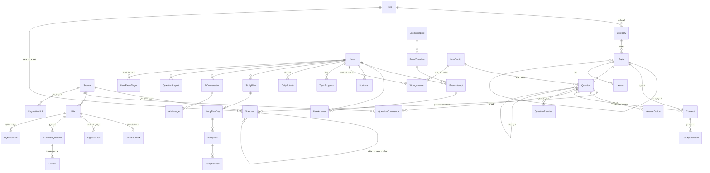

# 04 — تصميم قاعدة البيانات

> المخطط الكامل: [`packages/db/prisma/schema.prisma`](../packages/db/prisma/schema.prisma) (54 جدولًا)، والهجرة الإضافية: [`prisma/sql/search_and_guards.sql`](../packages/db/prisma/sql/search_and_guards.sql). طُبّقا على PostgreSQL 16 حقيقي، و`prisma migrate diff` بعدهما فارغ (لا انحراف).

## 1. لماذا PostgreSQL؟
- المحتوى **علائقي بطبيعته** (سؤال ← خيارات ← مفاهيم ← مصادر ← ظهورات ← محاولات ← إجابات)، والتحليلات (أكثر الأسئلة خطأً، أصعب المحاور) استعلامات SQL مباشرة.
- يوفر في قاعدة واحدة: البحث النصي (`tsvector`)، والبحث التقريبي (`pg_trgm`) لكشف التكرار والأخطاء الإملائية، والبحث الدلالي (`pgvector`) للمساعد الذكي. **لا نحتاج خدمة بحث منفصلة في البداية.**
- يعمل طابور المهام (`IngestionJob`) داخله بـ `FOR UPDATE SKIP LOCKED`، فلا نحتاج Redis.

## 2. الخريطة العامة (ERD مبسط)

## 3. الجداول المطلوبة ← ما يقابلها في المخطط

| طلبك | الجدول | ملاحظات التصميم |
|---|---|---|
| Users | `User` + جداول المصادقة + `UserExamTarget` + `UserConsent` | البريد إلزامي؛ موعد مستقل لكل اختبار؛ سجل موافقات لإثباتها نظاميًا |
| Questions | `Question` + `ItemFamily` | أصل الصياغة (`origin`)، **أساس المفتاح** (`answerBasis`) ومرجعه ومن تحقق منه، الثقة، `scorable`، المجموعة المحجوزة (`pool`)، أصل الشرح ومن راجعه، بيانات التوليد الآلي |
| Answers | `AnswerOption` | صحيح واحد فقط (مُختبر)، وهل الخيار من المصدر، ولماذا هو خطأ، ولا يُحذف بعد الإجابة عليه |
| Categories | `Track` ← `Category` | الوزن مؤقت حتى التحقق (`weightVerified`) ومرتبط بمصدره |
| Topics | `Topic` (شجرة) + `Concept` + `ConceptRelation` | المفاهيم لها حالة مراجعة وأمثلة وأمثلة مضادة، والمتشابهة لها قواعد تمييز |
| Sources | `Source` + `RegulationLink` | النوع، الدورة والعهد (كفايات/رخصة)، **الأصل المشتق منه**، سجل الإصدارات، حقوق الاستخدام |
| Exams | `ExamBlueprint` + `BlueprintItem` + `ExamTemplate` | مخطط الاختبار (العدد، الزمن، الأوزان) بإصداره ومصدره وحالة التحقق |
| ExamAttempts | `ExamAttempt` | مؤقت من الخادم، إيقاف واستكمال للتشخيص، وكل جلسة تدريب محاولة |
| UserAnswers | `UserAnswer` | نسخة المفتاح عند التصحيح (لإعادة التصحيح)، معرّف من الجهاز (حفظ بلا تكرار، مُختبر)، أول تعرض |
| Bookmarks | `Bookmark` | محفوظ ⭐ / علامة للمراجعة ⚑ |
| WrongAnswers | `WrongAnswer` + `SrsReviewLog` | بطاقة FSRS **لكل عائلة أسئلة**، وسبب الدخول (خطأ/تخمين)، وسجل كل مراجعة |
| StudyPlans | `StudyPlan` ← `StudyPlanDay` ← `StudyTask` | المواعيد من أهداف الطالب، وكل مهمة لاختبار محدد |
| StudySessions | `StudySession` | جلسات فعلية مرتبطة بمهام الخطة |
| Files | `File` + `IngestionRun` + `IngestionJob` + `ContentChunk` | كل معالجة "دورة" لا تحذف ما قبلها؛ طريقة الاستخراج وصورة الصفحة لكل مقطع |
| ExtractedQuestions | `ExtractedQuestion` | النص الخام، حالة الإجابة، سياسة النشر، النموذج ونسخة الـ prompt، أولوية المراجعة |
| Reviews | `Review` (تحريرية) + `QuestionReport` (بلاغات الطلاب) | البلاغ يرتبط بالتعديل الذي أصلحه |
| Progress | `TopicProgress` + `DailyActivity` + `LessonProgress` | الإتقان من أول تعرض فقط |

**إضافات أخرى:** `Standard` + `QuestionStandard` (المعايير الرسمية وربطها المؤكد/المبدئي)، `QuestionOccurrence` (أين ظهر السؤال)، `QuestionRevision` (سجل التعديلات)، `Lesson` + `LessonConcept` (ذاكر، المواقف المحلولة، المفاهيم المتشابهة)، `SearchSynonym` (مرادفات المجال)، `AiConversation/AiMessage` + `ContentGap` (المساعد وما لم يجده)، `NotificationPreference` + `PushSubscription` + `DataExportRequest`، `Purchase`، `AuditLog`.

## 4. قرارات تصميم مهمة (وكلها مُختبرة على PostgreSQL 16)

الاختبارات في [`packages/db/tests/schema_guards.sql`](../packages/db/tests/schema_guards.sql)، وتنجح العشرة كلها:

| # | القاعدة | كيف تُفرض |
|---|---|---|
| 1 | **حذف حساب طالب دفع لا يفشل:** بياناته التعليمية تُحذف، وفاتورته تبقى بلا اسم (لهيئة الزكاة) | كل علاقة بالمستخدم إما حذف متتالٍ أو تصفير |
| 2 | **حذف حساب المؤسس أو محرر** يُبقي المراجعات وسجل التدقيق والأسئلة والملفات | تصفير المرجع |
| 3 | خيار صحيح واحد فقط | فهرس فريد جزئي |
| 4 | لا نشر لسؤال مفتاحه يحتاج مرجعًا بلا مرجع | قيد CHECK |
| 5 | لا يدخل التصحيح مفتاح من مصدر واحد أو مختلف عليه | قيد CHECK |
| 6 | تصنيف السؤال متسق (مجاله = مجال محوره) | مفتاح أجنبي مركب |
| 7 | لا حذف لسؤال أجاب عليه طلاب (أرشفة فقط) | Restrict |
| 8 | إعادة إرسال الإجابة بعد انقطاع لا تكررها | معرّف فريد من الجهاز |
| 9 | البحث التقريبي يعمل على العربية | فحص `show_trgm` يوقف الهجرة إن كان إعداد اللغة خاطئًا |
| 10 | البحث النصي والتقريبي في مخطط `search` | اختبار استعلام |

**قرارات أخرى:**
- **النص مرتين:** الأصلي للعرض، و`*Norm` مطبّع للبحث وكشف التكرار، بدالة واحدة مشتركة بين الموقع والـ Worker.
- **الظهورات بدل النسخ:** السؤال المكرر لا يُنسخ؛ يضاف له `QuestionOccurrence` (مرة واحدة لكل مصدر). والتكرار يُحسب من مصادر غير مشتقة من بعضها ودورات مختلفة، ويُعرض على مستوى المفهوم.
- **لقطة الإعدادات في المحاولة:** تعديل قالب الاختبار لاحقًا لا يغير نتائج قديمة.
- **إعادة التصحيح:** كل إجابة تحفظ نسخة المفتاح التي صُححت بها، فإذا أُصلح مفتاح بعد بلاغ تُعاد الإجابات المتأثرة.
- **الإحصاءات الليلية** (`correctRate`, `discrimination`) من أول تعرض فقط. السؤال الذي يخطئ فيه المتفوقون أكثر من غيرهم غالبًا مفتاحه خاطئ، فيظهر للمؤسس.
- **الأنظمة المتغيرة:** عند وسم إصدار نظام "ملغى"، تُعلَّم كل الأسئلة والدروس والمفاهيم المرتبطة به (`needsReview`).
- **Prisma 6.x مثبت** (Prisma 7 ينقل رابط القاعدة إلى `prisma.config.ts`).

## 5. الفهارس والبحث

> **شرط إلزامي:** تُنشأ القاعدة بترميز UTF8 و`LC_CTYPE` = `C.UTF-8` أو ICU. في تجربة أولية لم يستخرج `pg_trgm` أي مقطع من النص العربي مع `LC_CTYPE=C`، فيتعطل البحث التقريبي بصمت. لذلك تبدأ الهجرة بفحص يوقفها إن كان الإعداد خاطئًا.

- **فهارس الحروف (trigram)** على `stemNorm` و`nameNorm` و`titleNorm`: معرّفة في Prisma نفسه.
- **البحث النصي والدلالي** في مخطط مستقل اسمه `search` (جداول `question_index` و`chunk_index` و`extracted_index`): نص مطبّع + `tsvector` بإعداد `simple` + متجه `vector(1024)` بفهرس HNSW. يكتبها التطبيق والـ Worker عند تغير النص أو المتجه، وتُحذف تلقائيًا مع المحتوى.
- **لماذا مخطط مستقل؟** اختُبر أن Prisma يعتبر فهارس HNSW وtsvector على جداوله "انحرافًا" ويحذفها في الهجرة التالية. في مخطط لا يديره Prisma تبقى سليمة، و`migrate diff` يبقى فارغًا (اختُبر).
- **لماذا `simple` لا `arabic`؟** المُجذِّع العربي المدمج في PostgreSQL أعطى في تجربة أولية جذورًا مختلفة للكلمة مع "ال" وبدونها ("توجيه" لا تطابق "التوجيه")، فنطبّع ونحذف السوابق الخفيفة في التطبيق بدلًا منه.
- أبعاد المتجه 1024 تناسب BGE-M3، وتُضبط حسب النموذج المختار.

التفاصيل في [`packages/db/prisma/sql/search_and_guards.sql`](../packages/db/prisma/sql/search_and_guards.sql).
